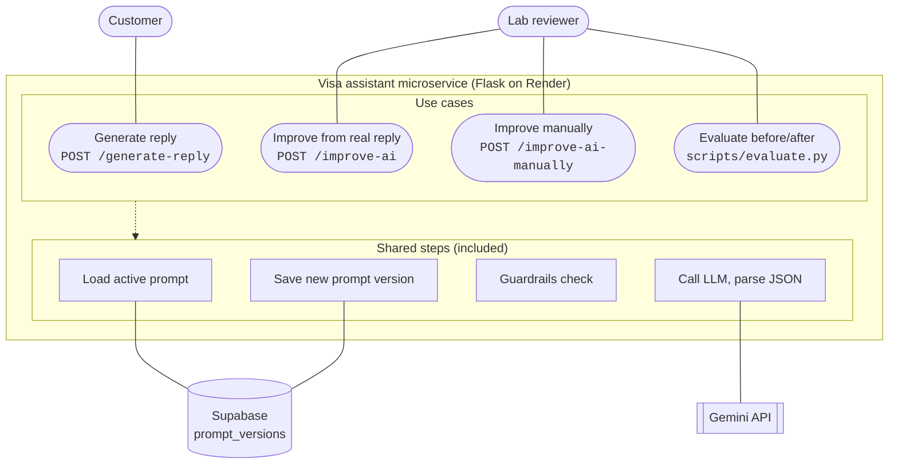

# 2. Findings: the data and how the system works

This document covers what the sample data shows, what kinds of questions clients ask, and how the parts of the system fit together.

- Spreadsheet: [`question_distribution.xlsx`](question_distribution.xlsx)
- Raw statistics: `python scripts/analyze_data.py`
- Longer data notes: [`DATA_INSIGHTS.md`](DATA_INSIGHTS.md)

---

## 2.1 How the system works (use case diagram)

_If the diagram doesn't render, see [`images/use_case_diagram.png`](images/use_case_diagram.png)._

| Use case | Who | Load prompt | Call LLM | Guardrails | Save version |
|---|---|:-:|:-:|:-:|:-:|
| Generate reply | Customer | ✓ | ✓ | | |
| Improve from real reply | Lab reviewer | ✓ | ✓ (twice: predict, then edit) | ✓ (strict) | ✓ if accepted |
| Improve manually | Lab reviewer | ✓ | ✓ | ✓ (looser) | ✓ if accepted |
| Evaluate before/after | Lab reviewer | ✓ (any version) | ✓ (reply + judge) | | |

> **✏️ JAMES: WRITE 1–2 SENTENCES HERE ON WHY YOU WANTED A USE CASE DIAGRAM BEFORE ANY CODE WAS WRITTEN.** (FOR EXAMPLE: YOU WANTED TO AGREE WHO USES THE SYSTEM AND WHICH STEPS ARE SHARED BEFORE BUILDING, THE SAME WAY YOU WOULD SCOPE A SYSTEM AT WORK.) DELETE THIS LINE AFTERWARDS.

---

## 2.2 Shape of the data

| | |
|---|---|
| Conversations | 15 (synthetic, `SYNTH_001`–`SYNTH_015`), each a different scenario |
| Client turns (client message(s) → real consultant reply) | **128** |
| Turns where the client sent 2+ messages in a row | 2 |
| Conversations started by the consultant (follow-up) | 1 (`SYNTH_012`) |
| Attachments (`[Non-text message]`) | 4 |
| Train / test split | 85 turns (10 conversations) / 43 turns (5 conversations: `SYNTH_011`–`015`) |

The split is **by conversation**, so the evaluation never sees a conversation the prompt learned from.

## 2.3 What clients ask about (question types)

Every client turn is labelled with one of 13 types by deterministic keyword rules (`app/categories.py`). The rules use no LLM calls, so labelling is free and repeatable. The full table, both charts and every labelled message are in [`question_distribution.xlsx`](question_distribution.xlsx).

| Question type | Turns | Share | Train | Test |
|---|---:|---:|---:|---:|
| Progress update (high intent) | 16 | 12.5% | 9 | 7 |
| Documents | 15 | 11.7% | 11 | 4 |
| Where & how to apply | 14 | 10.9% | 9 | 5 |
| After approval & staying | 13 | 10.2% | 6 | 7 |
| Sharing situation | 12 | 9.4% | 9 | 3 |
| Timeline & processing | 11 | 8.6% | 6 | 5 |
| Fees & guarantee | 10 | 7.8% | 4 | 6 |
| Bank balance & finances | 9 | 7.0% | 7 | 2 |
| Thanks & closing | 8 | 6.3% | 7 | 1 |
| Embassy interview | 7 | 5.5% | 7 | 0 |
| Payment | 6 | 4.7% | 3 | 3 |
| DTV rules & eligibility | 4 | 3.1% | 4 | 0 |
| Rejection & reapplication | 3 | 2.3% | 3 | 0 |
| **Total** | **128** | **100%** | **85** | **43** |

**What this shows**
- The data is **imbalanced**. The top three types make up 35% of turns, while rejections (2.3%) and eligibility edge cases (3.1%) are rare. Those rare cases are also the riskiest to get wrong.
- Embassy interviews, eligibility and rejections appear **only in the training set**, so the evaluation can't measure them. This is a known gap; see [3.6](3_IMPROVEMENTS_AND_RESULTS.md#36-strengths-weaknesses-and-limitations).
- This imbalance is why training uses **category-balanced sampling**; see [3.2](3_IMPROVEMENTS_AND_RESULTS.md#32-how-the-data-was-used-for-training-balanced-sampling).

> **✏️ JAMES: WRITE 2–3 SENTENCES HERE ON WHY YOU WANTED THIS QUESTION-TYPE BREAKDOWN AND WHAT YOU NOTICED.** IT WAS YOUR IDEA. SAY WHAT YOU WANTED TO LEARN FROM IT, AND WHICH NUMBER SURPRISED YOU OR CHANGED WHAT YOU DID NEXT (FOR EXAMPLE, THE RARE REJECTION CASES LEADING TO BALANCED TRAINING). DELETE THIS LINE AFTERWARDS.

## 2.4 How the real consultants write

| Signal | Value | How the seed prompt uses it |
|---|---|---|
| Reply length | median 36 words (14–67) | Aim for 15–60 words; go longer only for lists |
| Numbered or bulleted lists | 33% of replies | Lists only for 3+ documents, options or steps |
| Asks the client a question | 18% | At most 1–2 questions, only when info is missing |
| Emoji | 4% | At most one, for celebrations or encouragement |
| Common first words | "Yes", "For", "You're", "Hello" | Answer the question in the first sentence |

"Human and casual" here means **short, direct and warm**, not slang. The seed prompt (`prompts/reply_seed.md`) targets that register.

## 2.5 High-intent signals and drop-offs

| Signal (client says…) | Conversations |
|---|---:|
| Gives a timeline or urgency ("expires", "tonight", "next week") | 8 / 15 |
| Has downloaded the app, signed up or is uploading | 6 / 15 |
| "How do I start?" / "What's the first step?" | 4 / 15 |
| Is paying or sends a receipt | 3 / 15 |
| Already has documents ready | 2 / 15 |

Consultants respond to these by moving straight to the next concrete step: app, then sign-up email, then free review, then payment. The prompt encodes that funnel.

**Drop-offs and ghosting: there are none in this data.** All 15 conversations end with a consultant message, and no client turn goes unanswered. Ghosting patterns can't be learned from this dataset, so none were invented. With real data I would compare the last consultant message in conversations where the client went silent against those that continued.

## 2.6 Problems in the data the bot must *not* learn

These were found by reading the conversations, and they shaped the guardrails:

1. **Arithmetic error.** Three conversations (`SYNTH_003`, `010`, `014`) quote Laos as a 5,000 THB service fee plus a 10,000 THB government fee, then call that "18,000 THB total". It's 15,000.
2. **Claims of system access.** Consultants say "I found your account" and "Payment received". The bot has no such access, so copying this would make it lie.
3. **Coaching what to tell the embassy.** Some replies advise leaving out Thai clients. That is risky advice for a bot that sits before the legal team.
4. **Placeholders** such as `[APP_LINK]`, `[EMAIL]` and `[BANK_NAME]`, which are anonymisation leftovers.

The editor prompt has a "never learn" list for all four, and `check_prompt_edit()` in `app/assistant.py` blocks them in code as well.

> **✏️ JAMES: OPTIONAL. IF YOU READ THROUGH THE CONVERSATIONS YOURSELF, ADD ONE THING YOU NOTICED THAT ISN'T LISTED ABOVE.** IF NOT, DELETE THIS LINE.
